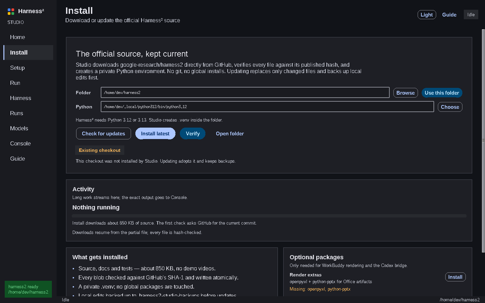
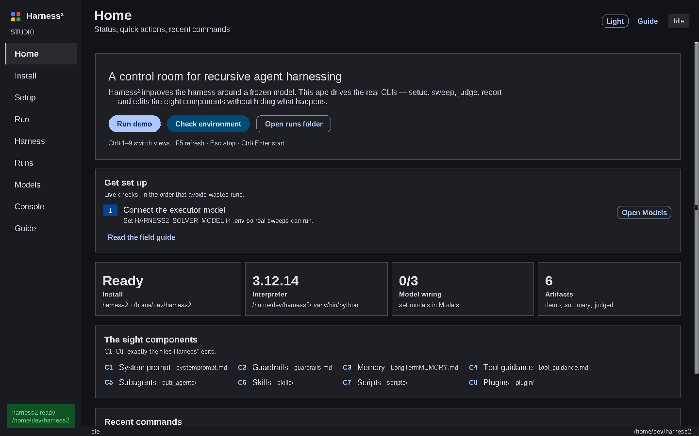
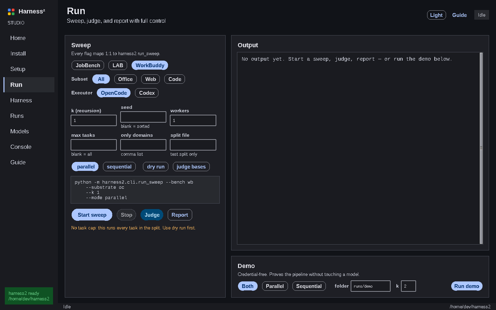
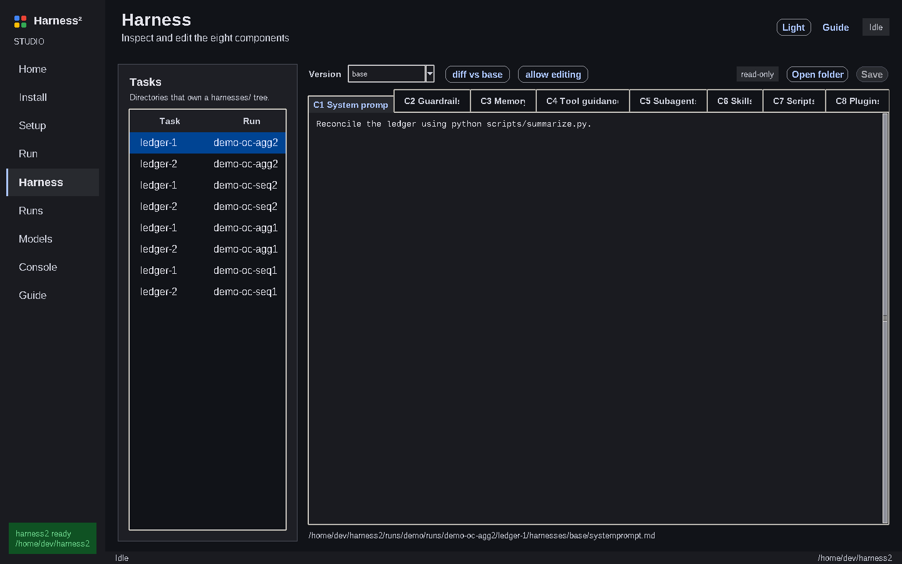
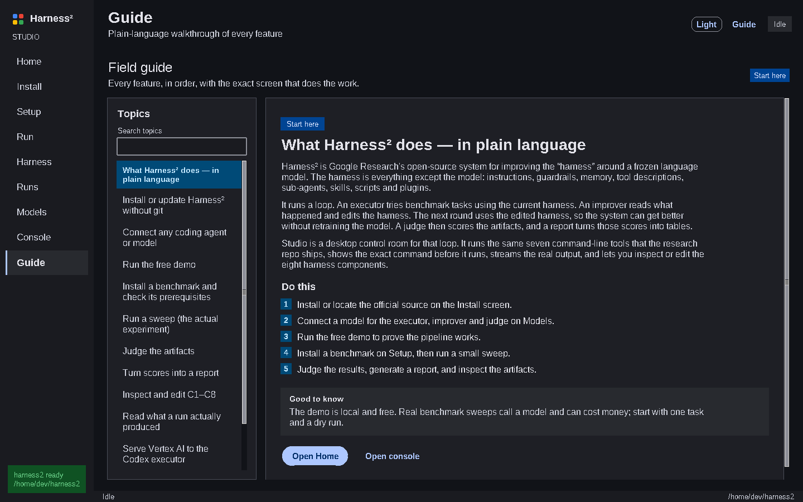
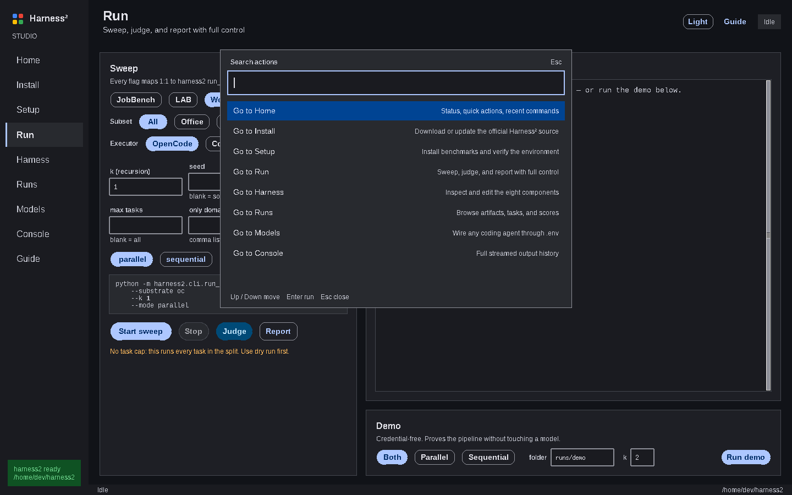

# Harness² Studio

[](https://github.com/dev4aibots/harness2-studio/actions/workflows/ci.yml)


A desktop control room for [Harness²](https://github.com/google-research/harness2) — recursive agent harnessing — built with Google's Material 3 language and **zero third-party runtime dependencies**.

Harness² is a CLI framework: seven `argparse` commands, a `runs/` tree, and eight editable harness components. This app puts a real interface on that surface — no mock data, no invented buttons. It can also **install or update the official source for you**, without git, and verify every downloaded file against GitHub's hash.



## What it covers (A–Z)

| Harness² capability | In the UI |
|---|---|
| Install / update the source | **Install** → Check for updates, Install latest, Verify, optional packages, resumable downloads, per-file SHA-1 checks |
| `harness2-setup jb\|lab\|wb` | Setup → Install benchmark (subset + substrate + dry run) |
| `harness2-check` | Setup → Check environment, with `FAIL/WARN/OK` parsed into a verification list |
| `harness2-setup` prerequisites | Live checks: Python, git, uv, node, OpenCode checkout, bun, pandoc, poppler, Docker daemon |
| `harness2` sweep | Run → bench, subset, substrate, `--k`, seed, modes, split, split-file, workers, only-domains, max-tasks, dry run |
| `harness2-judge` | Run → Judge (identity-locked to the same bench/k/seed/mode), `--bases` |
| `harness2-report` | Run → Report (`--k` comma list) |
| `harness2-demo` | Run → Demo, and Home quick action |
| `harness2-bridge` | Models → Bridge: model, host, port; long-running, output streams to Console |
| The eight components (C1–C8) | Harness → per-task, per-version viewer with diff vs base and guarded editing |
| A harness to start from | [harness-pack/](harness-pack/) → the authored C1–C8 set, validated against the surface rules and installable with one copy |
| Evidence it helps | [bench/](bench/) → a controlled A/B (same model, tools and loop; only the harness differs), with the raw JSONL and the published Opus numbers kept separate |
| `runs/` artifacts | Runs → demo/summary/judged/base-judged, raw JSON, one-click copy |
| Scores over time | **Tracker** → every sweep with its score, delta vs the previous run, and the component the next edit should target |
| Driving a coding agent | **OpenCode** → run `opencode` headless from the UI, streamed into Console; no terminal needed |
| `.env` model wiring | Models → solver, improver, judge, judge base URL/key, runs dir, GCP project/location, per-role reasoning effort |
| Resume semantics | Same identity reuses `summary.json`; the app makes the identity visible before you launch |
| Learning the product | **Guide** (also in the header) explains every feature and error in plain language |







## First five minutes

1. **Install.** Open Install, choose an empty folder (default `~/harness2`), press **Check for updates**, then **Install latest**. The app downloads the source, verifies it, creates `.venv`, and proves the package imports. No git is required.
2. **Connect a model.** Open Models and fill the executor (`HARNESS2_SOLVER_MODEL`), improver and judge. Keys are written to the checkout's `.env`, never to the app's state, and are masked on screen.
3. **Prove it for free.** Open Run → Demo and press Start. The deterministic demo needs no credentials and writes `runs/demo`.
4. **Read the output.** Open Runs, select the artifact, inspect the JSON, then open Harness to read C1–C8.
5. **Go real, small.** Install a benchmark on Setup; run one task with `k=1`, one worker and a task cap. Judge it, then generate a report.

The in-app **Guide** (top-right, contextual to the screen you were on) covers installation, models, benchmarks, sweeps, judging, reports, harness editing, artifacts, the Codex bridge, troubleshooting by exact error, and a glossary.

## Install the app

### Requirements

- Python **3.10+** with Tk 8.6+ (python.org macOS/Windows builds include it; Debian/Ubuntu: `sudo apt install python3-tk`).
- A network connection for the Harness² source install. Benchmark datasets and Docker images are separate, upstream-managed downloads.
- Python **3.12 or 3.13** for Harness² itself. The Install screen lets you point at a specific interpreter; the app can run on 3.10/3.11 while creating a 3.12 venv elsewhere.

### Run from a checkout

```bash
git clone https://github.com/dev4aibots/harness2-studio.git
cd harness2-studio
python3 run.py          # normal launch
python3 run.py --check  # construct + destroy without showing the window
```

On Windows: `py run.py`.

If `python3` lacks Tk, point at a Tk-enabled interpreter (for example `/home/dev/.local/python312/bin/python3.12 run.py`); the launcher prints that instruction instead of a traceback.

### Install as a command

```bash
python -m venv .venv
. .venv/bin/activate            # Windows: .venv\Scripts\activate
pip install setuptools wheel    # build backend (skip if your env already has it)
pip install --no-build-isolation -e .
harness2-studio
```

`pip install -e .` also works with normal build isolation when PyPI is reachable. A wheel build includes the icon and every view; `harness2-studio --check` verifies the installed entry point.

Linux desktop launcher (optional):

```bash
packaging/install-desktop.sh
```

## How auto-install works

The Install screen is not a shell around `git clone`:

1. Ask GitHub for the current `main` commit and its recursive tree.
2. Keep only source, docs, tests, scripts and third-party provenance — skip demo videos and assets. The audited tree is **107 files / 848,099 bytes**.
3. Download with six workers, streaming into `.part` files, resuming with HTTP Range, trying GitHub raw and jsDelivr.
4. Keep partial bytes through connection drops and short bodies; verify every file against its **git blob SHA-1** from the tree API, then write atomically. Full-length mismatches are corruption and are retried from a clean part.
5. Create a private `.venv` (falling back to `--without-pip` when ensurepip is unavailable) and add a `.pth` so the checkout imports from any working directory.
6. Run `harness2.cli.demo --help` to prove the package imports.
7. Write `.harness2-studio.json` with the commit, date, version and every installed hash.

Updates re-plan against the new tree: unchanged files are skipped, pristine old files are replaced, and files you edited locally are copied to `.harness2-studio-backups/<timestamp>/` first. `runs/` and `.env` are never touched. If the download is interrupted, press Install latest again; partial files resume.

The app also accepts an existing checkout (**Use this folder**) and can install the optional `render` and `bridge` package groups inside the checkout's venv.

## Keyboard

| Keys | Action |
|---|---|
| `Ctrl+K` | Command palette |
| `Ctrl+1…9` | Home, Install, Setup, Run, Harness, Runs, Models, Console, Guide |
| `Ctrl+Enter` | Start the primary action of the current view |
| `F5` | Refresh current view |
| `Esc` | Stop the running command (asks first) |
| `Ctrl+=` / `Ctrl+-` / `Ctrl+0` | UI scale 85–160% |
| `Tab` / `Shift+Tab` | Move through controls (text areas never trap focus) |

## Design

Material 3 tokens, seeded on Google Blue `#0B57D0`:

- **Colour** — full role set for light and dark (`surface`, `surface-container`, `primary`, `on-*`, `outline`, `error`, …), verified at 4.5:1 body contrast and 3:1 UI contrast.
- **Type** — Google Sans → Product Sans → Roboto → Noto Sans → Liberation Sans, resolved against the fonts the OS actually has (12–32 px scale); monospace for commands, JSON, and harness files. The family is verified at startup, so the UI never silently falls back to Tk's 10 px `fixed`.
- **Shape** — outlined cards (1 px `outline-variant`) instead of fake shadows: Tk cannot render real elevation, and grey halos read as a 2009 web port.
- **State layers** — hover 8%, press 12%, precomputed colour blends, animated over 120 ms.
- **Density** — 30 px table rows, 8 px spacing grid, 32 px minimum targets.
- **Honest motion** — pointer-path feedback, a 64 ms palette entrance and a toast slide; no decorative animation, ripples or scroll effects.
- **Plain language** — the Guide names the exact screen, the exact key and the exact recovery step; error text comes from the real process.

Details and the reasoning: [docs/DESIGN.md](docs/DESIGN.md).

## Architecture

```
run.py                     entry point (also --check)
h2studio/
  app.py                   shell, nav, log bus, process lifecycle, cancellable tasks, palette
  guide_content.py         plain-language A–Z guide data
  theme.py                 M3 tokens, type scale, ttk styling
  widgets.py               Pill, Toggle, Card, Chip, ProgressBar, Console, Scroller, ConfirmDialog
  palette.py               Ctrl+K quick switcher
  services/
    h2.py                  argv builders, validation, env merge, streaming, process-tree stop
    installer.py           GitHub tree/commit, resumable hash-checked download, venv, extras
    runs.py                artifact + harness indexing, unified diff
    envfile.py             comment-preserving .env writer
    models.py              model discovery from the local opencode CLI
    requirements.py        live prerequisite checks
    state.py               atomic UI state
  views/                   home, install, setup, run, harness, runs, models, console, guide
  assets/                  window icon (PNG/SVG)
packaging/                 Linux .desktop entry + optional launcher installer
tests/                     service, installer, workflow, GUI smoke
tools/                     selftest, button audit, e2e, screenshots
```

Rules the code follows:

- The UI never shells out through a string; `services/h2.py` builds argv lists and validates them.
- Worker threads never touch Tk; output and task progress cross a queue and are drained on the main loop.
- Every process runs in its own process group and is stopped with SIGTERM → 3 s → SIGKILL.
- Harness editing is read-only by default, disabled in diff view, refuses truncated files, and always writes a timestamped `.bak` first.
- Installer paths are allowlisted, traversal is rejected, hashes are verified, and no remote code runs during install beyond `--help`.
- The app itself has no telemetry, accounts or cloud storage.

## Verification (what was actually run)

```bash
ruff check .                                  # clean
PYTHONPATH=. python3 -m pytest -q             # 44 passed, 1 skipped (Tk-less host)
python3.12 tools/button_audit.py              # 11 views · 71 documented controls · 9 stages
```

```bash
python3.12 run.py --check                     # GUI constructed and destroyed
python3.12 tools/smoke.py                     # every view + theme toggle x2
python3.12 tools/selftest.py                  # behavioural assertions
python3.12 tools/e2e.py                       # GUI-driven demo → runs/demo
python3.12 tools/shoot.py                     # real screenshots, both themes
```

The first block is the current gate run; the second was observed in an earlier pass and is
recorded in [docs/VERIFICATION.md](docs/VERIFICATION.md). Highlights from those passes:

- **Auto-install end-to-end from an empty folder:** 107 files / 848,099 bytes in 97.7 s, hash-verified, venv created, import verified. A real `harness2-demo --k 1` in that fresh checkout completed **2 tasks, 0 failed**. Downloads now stream into `.part` files chunk by chunk, so a dropped or slow connection resumes from the last byte instead of restarting the file.
- **Update path:** a local edit was backed up, the upstream file restored, and a second update downloaded 0 files in 7.0 s.
- **Button audit:** every Pill/Toggle on all eleven screens has a callable command; every safe command was invoked against a disposable checkout; no unhandled Tk errors.
- **Packaging:** editable install and wheel build verified; the wheel contains `guide_content.py`, every view and the icon.

The observed output of every command is recorded in [docs/VERIFICATION.md](docs/VERIFICATION.md).

## CI

`.github/workflows/ci.yml` runs `ruff` and the service suite on Ubuntu, macOS and Windows for Python 3.12/3.13, plus an Xvfb GUI job that runs the smoke test and the button audit.

## Known limits

- **Accessibility tree**: Tk exposes no AT-SPI/UIA semantics for canvas-drawn controls. Keyboard access, focus rings, visible state text, and 4.5:1 contrast are implemented; screen-reader roles are not possible without changing toolkit.
- **Benchmark dependencies**: `harness2-setup jb|lab|wb` is upstream code and needs git/uv/Node/Docker and external datasets. The app runs it and surfaces every failure; it does not reimplement those downloads.
- **Network**: the source installer needs github.com, raw.githubusercontent.com and optionally cdn.jsdelivr.net. A proxy must allow them. Benchmark setup may need more hosts.
- **LAB / WorkBuddy judging**: Vertex-shaped upstream. JobBench accepts `HARNESS2_JUDGE_BASE_URL` + key, which is exposed in Models.
- **Fonts**: Google Sans and Roboto are not redistributed; the app uses them when installed and falls back by name resolution otherwise.
- **Bridge**: runs as a streamed foreground process; the app stops it with the same SIGTERM → SIGKILL path, but does not daemonize or restart it.

## License

MIT. Harness² itself is Apache-2.0 and remains a separate project.
